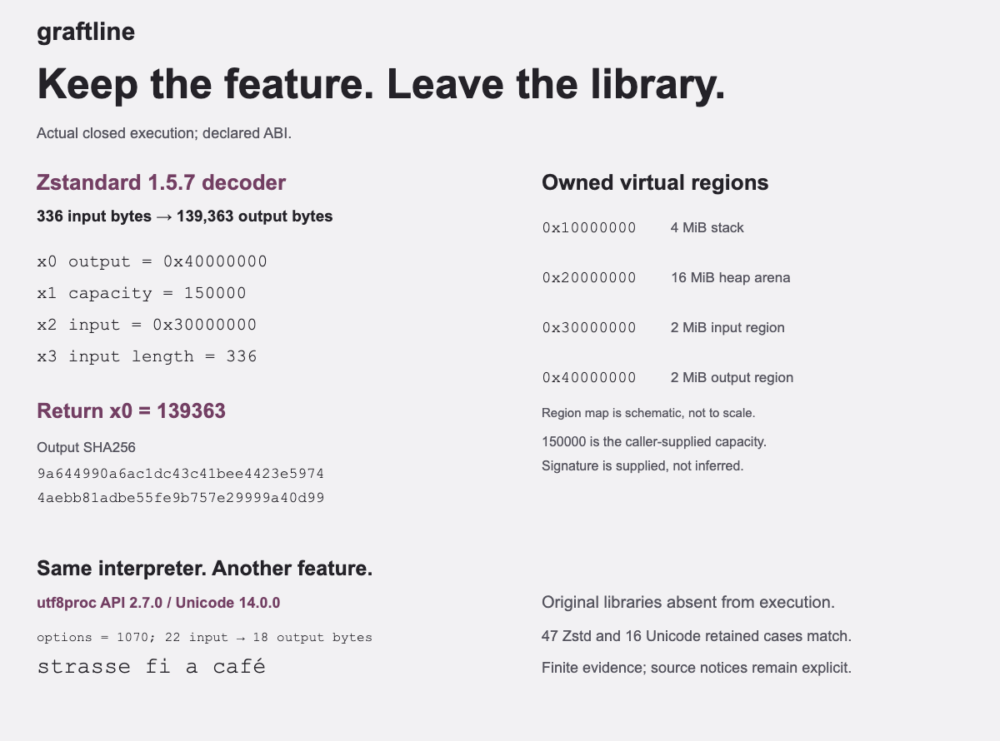

# Graftline

Run a selected native feature without loading its original library. Graftline
freezes extracted instructions, tables and a declared memory environment into
a callable artifact. This can preserve a specific native implementation inside
offline tools, compatibility tests or legacy migrations.

The local research repository includes two real shipped features: a Zstandard
decoder and a Unicode text transform. Both execute through the same generic
interpreter and caller-declared argument convention. Python 3.10 or later and
its standard library are sufficient for the shipped artifacts. No package
installation, native decoder, target application, API key or service is needed.

[Run and verify the frozen features](#run-verify-extract) · [Complete callable example](docs/presentation/README.md) · [Download the self-contained runner](docs/presentation/worked-example.zip)

The worked-example ZIP preserves its recorded source and receipts. Use the current checkout for the complete-output publication and failed-write recovery described below.

<picture>
 <source media="(max-width: 600px)" srcset="docs/presentation/declared-feature-mobile.png">
 
</picture>

**The feature stays callable. Its original library stays absent.** The actual CLI and API outputs match; a freshly extracted runner bundle reproduces the bytes with isolated standard-library Python. [Follow the registers, inspect the output and replay the complete example](docs/presentation/README.md).

From this directory, decode the genuine sample:

```sh
python3 -I -S run.py run features/zstd features/zstd/example.zst recovered.bin --param capacity=150000
```

It produces 139,363 bytes with SHA256
`9a644990a6ac1dc43c41bee4423e59744aebb81adbe55fe9b757e29999a40d99`.
Output files are created exclusively; existing output paths are refused.

Normalize compatibility characters and fold case:

```sh
python3 -I -S run.py run features/utf8proc features/utf8proc/example.txt normalized.txt --param options=1070
```

Inspect the new output with `cat normalized.txt`. The supplied `Straße fi Ａ Café` becomes `strasse fi a café`. Choose a new output path for another run; existing files are refused. A run stages and flushes the complete output before publishing it. A failed write leaves no partial final file, so you can retry the unoccupied path. If staging cleanup fails after publication, the complete output remains available and stderr identifies the leftover temporary. Option value 1070
combines the native library's stable, compatibility, composition, ignore and
case-fold flags. Options are explicit integers, not inferred user intent.
The frozen transform is **utf8proc API 2.7.0 / Unicode 14.0.0**, even though the
installed library basename was `libutf8proc.2.5.0.dylib`. It is not current or
complete Unicode compatibility by assertion.

## Run, verify, extract

The shipped `features/zstd` and `features/utf8proc` directories contain frozen
capsules and retained cases. `run.py run` transforms supplied bytes without
loading the original library; `run.py verify` compares the interpreter's results
with those cases. The final JSON line counts completed, matched and refused cases;
exit 0 requires a nonempty set where every case matches.

To capture a new feature, follow [EXTRACTION.md](EXTRACTION.md). Extraction is a
separate operation that loads an authorized, symbol-bearing ARM64 Mach-O dynamic
library and needs a declared ABI and fresh evidence. It is not a sandbox or an
arbitrary-binary extractor. It does not run when using the shipped capsules.

## Calling another extracted feature

`feature.json` binds an exact capsule SHA256 and entry address to a declared ABI,
the argument and return convention. Supported declarations are one input byte
buffer, input length, bounded unsigned scalars, and one owned output buffer or
allocated-output pointer cell. Arguments occupy x0–x7 and the return uses x0.
Exactly one input and one input length are required. Unknown ABI/argument/return fields, signed scalar declarations, unsupported widths, repeated input/input-length declarations and duplicate argument names refuse. Scalars use unsigned 64-bit register values; returns use unsigned 64-bit buffer lengths/errors or signed 64-bit allocated lengths/errors. Optional explicit width markers must be 64. Signatures are supplied by the caller, not inferred from machine code.

```python
from graftline import Feature
feature = Feature("features/utf8proc")
result = feature.call("Straße".encode(), options=1070)
assert result["output"] == b"strasse"
```

The API constructs fresh state for each call. `runtime.py` contains generic
integer instruction and memory semantics, not decoder or Unicode algorithms.
The capsules contain extracted programs and tables. The runner denies native
loading and lifting imports; it never falls back to the original library.

## Evidence and limits

| Frozen feature | Actual native source | Retained original code | Retained comparisons |
| --- | --- | --- | --- |
| Zstandard decode | Python-distributed libzstd 1.5.7 ARM64 slice | 404/1,438 text symbol bodies; 268,428 text bytes (14.55%), plus 336 import bytes | 47/47 native return/output comparisons |
| Unicode mapping | MATLAB-distributed utf8proc API 2.7.0 ARM64 library | 9/31 text symbol bodies; 4,248 text bytes (69.19%), plus 36 import bytes | 16/16 cases generated after the first Unicode runtime/extractor freeze |

Original implementation source and decoder/normalization specifications were
withheld. Public ABI declarations and copyright notices were allowed. Native
libraries were loaded only during explicit extraction and separate oracle
generation, which creates comparison cases. They are absent from this repository.

Retained case bytes, native expectations, results and provenance are in each feature directory. These finite comparisons do not establish complete correctness or security.

Each call allows at most 2 MiB input/output, a 16 MiB heap arena, a 4 MiB stack,
2,000,000 interpreted instruction steps and 15 seconds. Unknown code, operations,
memory, environmental dependencies or invalid declarations refuse. Fortified
memory helpers enforce their destination object bound. Every heap read/write, including interpreted LOAD/STORE and modeled memory helpers, must lie inside one live allocation's requested extent. Reallocation copies the
owned prefix into fresh storage and revokes old access; freed bytes and allocation padding are inaccessible. A zero-size allocation admits only zero-byte access, and one-past pointers admit only zero-byte access. Zero-size realloc refuses without changing the live allocation. Allocation failure, thread scheduling, host I/O and physical CPU/cache
behavior are not reconstructed. The allocation ledger is not a proof of all
native memory safety.

Code selection and tables are conservative: all initialized non-code sections
are retained; unused paths and indirect targets remain unproved. The Zstandard
capsule is larger than its native machine code in uncompressed JSON. Extraction
depends on available ARM64 Mach-O symbols and captured relocations. It is not a
general arbitrary-binary system, minimal transplant, new decoder, new Unicode
algorithm or first-invention claim. New targets require an authorized artifact,
an explicit ABI/environment and fresh witnesses. See [EXTRACTION.md](EXTRACTION.md).

## Verify

```sh
python3 -I -S run.py verify features/zstd features/zstd/cases.json
python3 -I -S run.py verify features/utf8proc features/utf8proc/cases.json
python3 -I -S tests/test_boundaries.py
```

The verifier exits nonzero for a mismatch, refusal or empty corpus. Receipt messages appear on stderr after successful publication or comparison; the existing case and summary JSON remain on stdout. Thirteen focused
boundary tests cover live heap bounds across guest/helper access, zero extents, ownership/reallocation, checked memory, repeated state,
identity/ABI validation, unknown paths/dependencies, verifier status and output
preservation, overlapping register values and direct/indirect control flow.
The included GitHub workflow runs these standard-library commands with a
five-minute job bound. See the [latest hosted CI status](https://github.com/nazeeh111/graftline/actions/workflows/verify.yml).

Project runtime/tools are MIT-licensed. Extracted Zstandard code/data remains
BSD-licensed; utf8proc code and Unicode data retain their included notices.
See [LICENSE](LICENSE). No upstream endorsement or name availability is claimed.

### Current validation receipts

Save a new receipt, then rerun and compare it:

```sh
python3 -I -S run.py verify features/utf8proc features/utf8proc/cases.json --receipt unicode-receipt.json
python3 -I -S run.py verify features/utf8proc features/utf8proc/cases.json --check-receipt unicode-receipt.json
```


`python3 -I -S run.py verify FEATURE CASES --receipt NEW.json` runs the same verifier and publishes a fresh receipt without overwriting an existing file. It records current engine source, exact feature/capsule/case and license hashes, Python identity, specimen terms, per-case return/output hashes and observed refusals. It records a failed or refused case as such and retains the usual nonzero exit. An interrupted write does not publish a partial receipt; retry with a new or unoccupied path.

`python3 -I -S run.py verify FEATURE CASES --check-receipt NEW.json` reruns those cases and compares the fresh result and inputs with the saved receipt. It does not execute commands from the receipt. The engine and files must remain stable during the run. These source hashes identify files observed around verification; they are not a signature, a guarantee against malicious concurrent replacement, proof of complete refusal coverage, or proof of native parity. `FREEZE.json`, `manifest.json` and retained results are historical records, not a manifest of the current checkout; this receipt identifies the current observed source and inputs without rewriting those records.

A receipt cannot be written as a `LICENSE`-prefixed file inside the specimen directory, because that would change the license set the receipt identifies. Receipt comparison preserves JSON value types, including the distinction between booleans and numbers.
