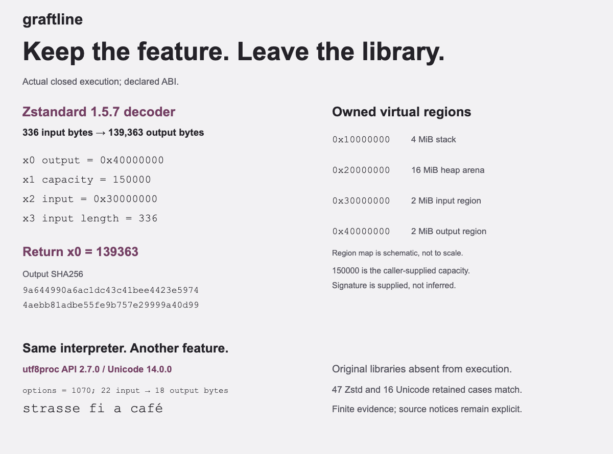

# Keep one native feature callable

A genuine 336-byte Zstandard frame becomes 139,363 output bytes through Graftline's frozen native program and generic interpreter. A second frozen feature turns 22 UTF-8 bytes into 18 normalized bytes through that same interpreter. This actual run uses only Python's standard library; neither original native library is loaded.

<picture>
 <source media="(max-width: 600px)" srcset="declared-feature-mobile.png">
 
</picture>

[Complete portable runner/example ZIP](worked-example.zip) · [Actual call record](journey.json) · [Zstandard output](zstd-output.bin) · [Unicode output](unicode-output.txt) · [Fresh Zstd receipt](zstd-receipt.json) · [Fresh Unicode receipt](unicode-receipt.json)

## Follow the declared call

For the decoder, the caller supplies:

```text
x0 = 0x40000000     owned output region
x1 = 150000         declared capacity
x2 = 0x30000000     input region
x3 = 336            actual input length
return x0 = 139363  output byte count
```

The produced bytes match the retained decoder specimen exactly:

```text
SHA256 9a644990a6ac1dc43c41bee4423e59744aebb81adbe55fe9b757e29999a40d99
```

The virtual stack starts at 0x10000000 with 4 MiB; the 16 MiB heap arena starts at 0x20000000; input/output regions each reserve 2 MiB. The active input is 336 bytes and this call's capacity is 150000; region size is not actual payload size. The figure's rows and boxes are schematic, not byte-proportional. Heap accesses use the live-allocation ledger; region bounds are not a universal proof of native memory safety. [Exact current runtime](../../graftline/runtime.py), [caller ABI wrapper](../../graftline/api.py), [source-bound figure generator](figure.py), [editable SVG](declared-feature.svg), [phone SVG](declared-feature-mobile.svg).

## A different feature, the same runtime

The actual supplied `Straße fi Ａ Café` becomes `strasse fi a café`. Its four declared registers instead represent input pointer, input length, allocated-output pointer cell and options 1070. The options are caller choices, not inferred normalization intent. The same `Feature` API constructs fresh interpreter state on each call; repeating this input produced identical output.

This is frozen utf8proc API 2.7.0 / Unicode 14.0.0, not a current-Unicode claim. The original installed filename's 2.5.0 suffix is not its reported API version. Decoder/Unicode algorithms and tables live in the licensed capsules; the authored Python runtime implements generic integer/memory operations and explicit environmental helpers. It does not substitute a handwritten Zstd or Unicode implementation.

## Run the actual CLI or API

From a complete source checkout, no installation:

```sh
python3 -I -S run.py run features/zstd features/zstd/example.zst NEW.bin --param capacity=150000
python3 -I -S run.py run features/utf8proc features/utf8proc/example.txt NEW.txt --param options=1070
```

The callable API returns the same output bytes:

```python
from graftline import Feature
feature = Feature("features/utf8proc")
result = feature.call("Straße".encode(), options=1070)
assert result["output"] == b"strasse"
```

The actual CLI run and API calls matched byte for byte. The CLI's audit hook denies native/lifting imports and original .dylib/.so access; the API journey installed that same audit hook before its calls. This is not a general Python sandbox or a claim that arbitrary caller code cannot import other modules.

The retained corpus replays matched 47/47 Zstd and 16/16 Unicode cases. Thirteen existing live-memory/ABI boundary tests and eight receipt tests passed. Those finite comparisons use retained native expectations; original libraries were not reopened to generate new native oracles. Observed instruction/helper counts remain in journey.json; they are not timings or a speedup claim.

## Refuse, preserve, replay

Actual controls refused Boolean capacity, missing/undeclared scalars, oversized input and an unsupported 32-bit scalar ABI. A bad compressed input returned its native error encoding and published no output. Reusing an existing output path refused and left its sentinel bytes intact. [Raw refusal record](journey.json).

Current public main already implements receipt publication and comparison. Both fresh receipts bind current engine source, exact capsule/ABI/corpus/license hashes, Python identity, case outputs and observed refusals. Unicode receipt comparison reran the cases successfully. Hashes detect differences; they authenticate neither the producer nor complete correctness. A receipt in a specimen's LICENSE namespace is deliberately refused so it cannot change the licensed-input identity it describes.

After extracting [worked-example.zip](worked-example.zip) into a fresh directory:

```sh
python3 -I -S run.py run features/zstd features/zstd/example.zst NEW.bin --param capacity=150000
python3 -I -S run.py verify features/utf8proc features/utf8proc/cases.json --check-receipt unicode-receipt.json
```

All imported runtime modules, both capsules, feature declarations, examples/cases, expected outputs, notices and manifest members are included. The extracted runner was executed and its bytes checked. The old target filesystem paths in feature metadata are informational provenance; those native files are absent and unnecessary. Python-version differences legitimately change receipt identity, so create a new receipt when the interpreter changes rather than relabeling an old one.

## Preserve the native owners and the boundary

Current source is 13261db3cf8778157398295f221aac93f975531a. The existing dirty engineering checkout was never read or copied. Fresh public branches contain only main; no pending extraction/receipt code was merged.

Graftline runtime/tools are MIT. The Zstandard capsule contains modified extracted code/data from libzstd 1.5.7 and retains Meta's BSD notice. The Unicode capsule retains utf8proc authorship and Unicode-derived data terms. The source describes MATLAB only as the historical distributor of that third-party library; MATLAB itself and proprietary components are not included or required. [Original modification/third-party notice](../../LICENSE), [Zstandard notice](../../features/zstd/LICENSE-Zstandard.txt), [utf8proc/Unicode notice](../../features/utf8proc/LICENSE.md).

The export is changed in representation and environment: selected instructions become p-code, code/tables are serialized, relocated addresses become virtual and environmental calls use bounded authored models. It is not an upstream release, a newly invented codec, a minimal transplant or a general arbitrary-binary extractor. Extraction is a separate authorized native-library operation, not performed here. [Full extraction prerequisites and limits](../../EXTRACTION.md).
